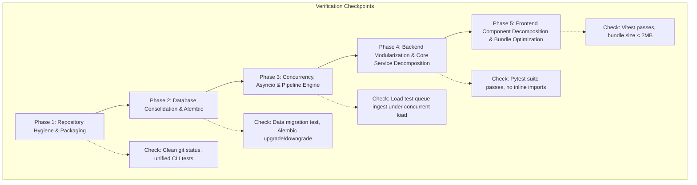

# ScanScribe Refactoring Master Plan: Engineering Specification & Roadmap

> **Target Codebase**: `ScanScribe` (Public Safety Radio Transcription & Incident Pipeline)  
> **Repository Root**: [`a:/Scanscribe_Projects/scanscribe`](file:///a:/Scanscribe_Projects/scanscribe)  
> **Status**: Approved for Execution  
> **Architecture Level**: Production Grade Enterprise Standard

---

## 1. Executive Summary & Problem Diagnosis

ScanScribe has evolved through roughly two years of incremental feature additions powered by early and modern frontier LLMs. While its core domain functionality is rich—combining local Whisper speech-to-text, Silero VAD gating, Named Entity Recognition (NER), OpenRouter incident routing, and interactive React mapping—the underlying architecture displays acute symptoms of **"Layer-Cake AI Archeology"**:

1. **Database Fragmentation**: Three disconnected SQLite databases (`scanscribe.db`, `scanscribe_logs.db`, `scanscribe_events.db`) without cross-table foreign key constraints.
2. **Fragile Runtime Migrations**: Startup PRAGMA column probing in [`app/database.py`](file:///a:/Scanscribe_Projects/scanscribe/app/database.py) with destructive auto-drop operations (`DROP TABLE IF EXISTS span_store`).
3. **Concurrency Hazards**: A cocktail of `threading.Lock`, `asyncio.Lock`, unpooled `threading.Thread` spawns, fire-and-forget `asyncio.create_task` calls lacking task references or shutdown drains, and blocking synchronous HTTP inside asynchronous worker loops.
4. **Monolithic God-Files & Import Cycles**: Multiple 1,000+ line files with 64+ inline function `import` statements masking circular dependency graphs.
5. **Polymorphic Data & Silent Failures**: 84+ broad `except Exception: pass` blocks and ambiguous fields (e.g., `units` storing either JSON arrays or CSV strings).
6. **Repository & Frontend Bloat**: Abandoned legacy frontend assets in the repo root, 6 conflicting setup scripts, and an unoptimized ~5.4MB Monaco Editor distribution bundle committed to git.

This master plan and its accompanying phase papers provide an agentic implementation blueprint to refactor ScanScribe into a clean, maintainable, high-performance system without breaking existing user features.

---

## 2. Multi-Paper Plan Structure

The refactoring is partitioned into five distinct, sequentially ordered phase papers. Each document contains exact file paths, before/after code specifications, database schemas, and verification criteria:

| Document | Phase Focus | Key Deliverables |
| :--- | :--- | :--- |
| [**`phase1_repository_hygiene.md`**](./phase1_repository_hygiene.md) | **Repo Hygiene & Packaging** | Purge root corpse files, unify Docker configs, consolidate 6 setup scripts into a single unified CLI, standardize lockfiles. |
| [**`phase2_database_consolidation.md`**](./phase2_database_consolidation.md) | **Database & Migrations** | Merge 3 SQLite DBs into a unified WAL-enabled DB, introduce Alembic migrations, enforce foreign keys, normalize data schemas. |
| [**`phase3_concurrency_async_pipeline.md`**](./phase3_concurrency_async_pipeline.md) | **Concurrency & Pipeline Engine** | Eliminate bare threads, implement bounded thread/task pools, make OpenRouter HTTP calls async, graceful lifespan drains. |
| [**`phase4_backend_modularization.md`**](./phase4_backend_modularization.md) | **Backend Modularity & Clean Code** | Decompose 1,000+ line god-files, untangle circular dependencies, eliminate 64 inline imports, eradicate blind `except Exception: pass`. |
| [**`phase5_frontend_architecture.md`**](./phase5_frontend_architecture.md) | **Frontend Architecture & Optimization** | Split monolithic React pages (`IncidentsPage.tsx`), optimize Monaco Editor bundle size, consolidate styling system. |

---

## 3. Dependency & Execution Flowchart

The refactoring phases must be executed in order. Changing the data layer before cleaning repository clutter causes merge conflicts, while attempting to modularize backend files before stabilizing database models results in circular import churn.

---

## 4. Architectural Rules of Engagement

Any autonomous agent or human developer executing these plans must adhere strictly to the following engineering tenets:

### Rule 1: Zero Regressions in Core Real-Time Ingest
ScanScribe's primary job is capturing audio transmissions from radio recorders (e.g. Trunk Recorder, SDR) in real-time, transcribing via Whisper, and routing incidents. Audio files entering the `ingest/` directory must **never** be dropped, delayed, or deadlocked during refactoring.

### Rule 2: Non-Destructive Data Migration
Production users possess real-world historical transcription logs in `scanscribe_logs.db` and active incidents in `scanscribe_events.db`. Under no circumstances may an automated script drop tables without verifying and executing a complete, lossless migration into the consolidated SQLite schema.

### Rule 3: Explicit Over Implicit Concurrency
No bare `threading.Thread(...)` calls and no untracked `asyncio.create_task(...)`. Every background task must be registered in a managed lifecycle pool that can report telemetry, catch unhandled exceptions, and drain cleanly on SIGINT/SIGTERM.

### Rule 4: Strong Type Contracts
Every API request and response payload must be defined via Pydantic v2 schemas on the backend and matching TypeScript interfaces on the frontend. No loose JSON strings pretending to be typed arrays.

---

## 5. Global Verification Checklist

Before marking the refactoring project complete, the following gates must pass:

- [ ] `git status` displays no untracked root corpses (`chartjs.css`, `dashboard.html`, etc.).
- [ ] Exactly one unified SQLite database file (`data/scanscribe.db`) operates with `PRAGMA journal_mode=WAL` and `PRAGMA foreign_keys=ON`.
- [ ] `alembic upgrade head` runs cleanly from scratch and idempotently against existing upgraded databases.
- [ ] All unit and integration tests pass via `pytest tests/`.
- [ ] All frontend unit tests pass via `npm run test` and TypeScript check passes via `npm run typecheck`.
- [ ] Grep count of inline `import` inside function bodies in `app/` is zero (`0`).
- [ ] Grep count of `except Exception: pass` is zero (`0`), with every error logged with appropriate severity or handled via domain error types.
- [ ] Frontend bundle size reduced from 5.4MB to < 2MB by eliminating unused Monaco Editor syntaxes.
