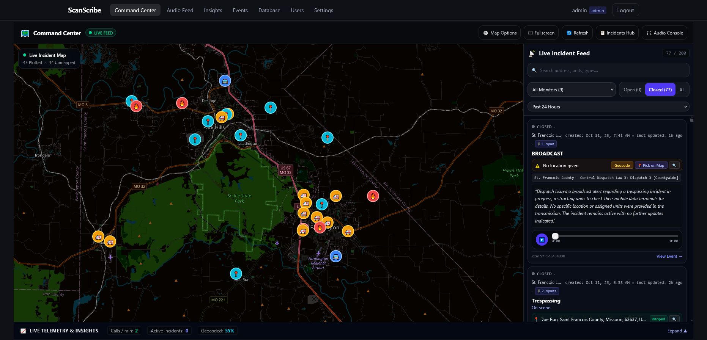
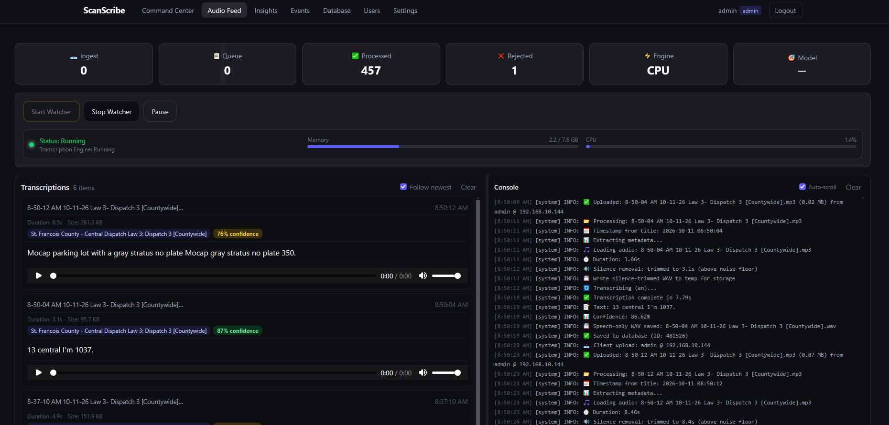
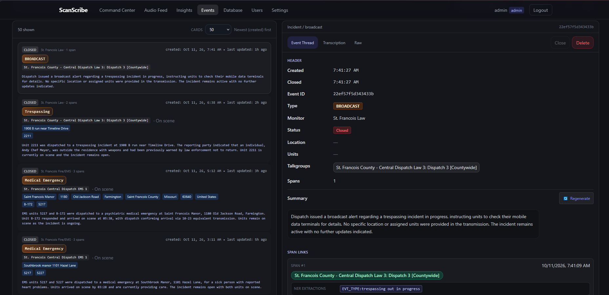
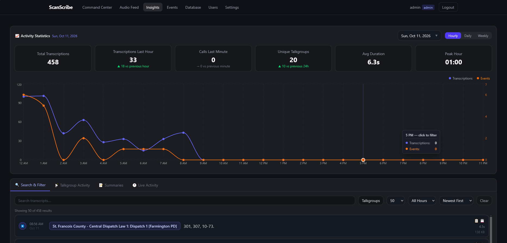
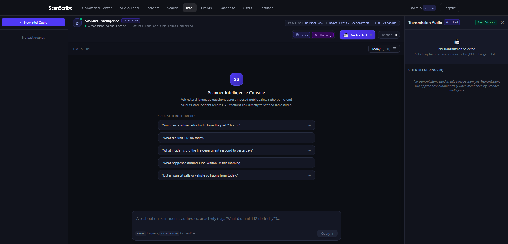
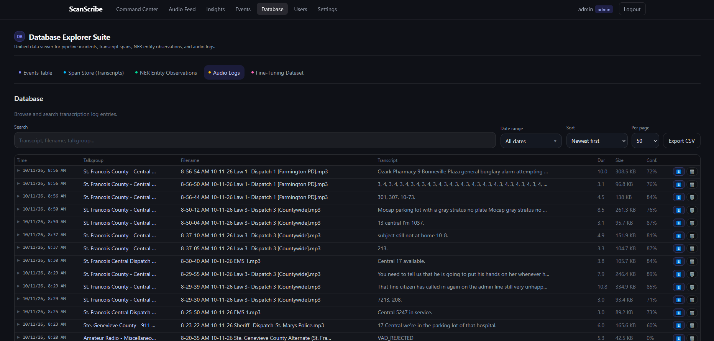
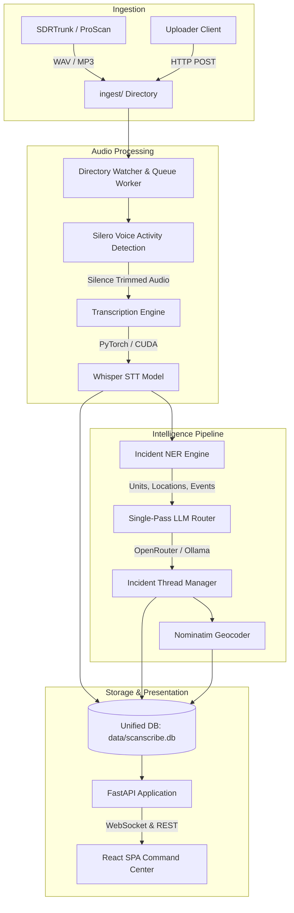

# ScanScribe

<p align="center">
  
</p>

<p align="center">
  <strong>AI-Powered Public Safety Radio Transcription, Incident Intelligence & Tactical Live Mapping</strong>
</p>

<p align="center">
  <a href="https://scanscribe.io"></a>
  <a href="https://github.com/xxbubziexx/ScanScribe/releases"></a>
  <a href="https://github.com/xxbubziexx/ScanScribe/stargazers"></a>
  <a href="https://python.org"></a>
  <a href="https://github.com/astral-sh/uv"></a>
  <a href="https://pytorch.org"></a>
  <a href="https://huggingface.co"></a>
  <a href="https://github.com/xxbubziexx/ScanScribe/blob/main/LICENSE"></a>
</p>

---

## Overview

**ScanScribe** is an enterprise-grade, end-to-end intelligence station purpose-built for public safety radio monitoring. It captures raw transmissions from SDR receivers (SDRTrunk) or hardware scanners (ProScan), runs high-throughput local speech-to-text with specialized public safety Whisper models, extracts incident entities (units, addresses, event types) using token-level NER, routes transmissions into real-time incident threads via single-pass LLMs, maps active calls live on a tactical Command Center, and powers conversational intelligence across historical radio traffic via the Scanner Intelligence Console.

Official Website & Documentation: **[https://scanscribe.io](https://scanscribe.io)**

Whether running as a dedicated field station on Windows or a 24/7 ingestion server on Linux, ScanScribe provides immediate situational awareness for dispatchers, researchers, and scanner hobbyists.

---

## Visual Showcase

### 🗺️ Tactical Command Center & Live Map
*Interactive geospatial dispatch map with real-time incident pins, live emergency call feeds, and inline waveform audio playback.*
<p align="center">
  
</p>

### 🎙️ Real-Time Audio Feed & Live System Telemetry
*Streaming radio audio processing feed with live confidence ratings, silence gate trimming, hardware resource meters, and streaming system logs.*
<p align="center">
  
</p>

### 🧠 Incident Intelligence Hub & Event Threads
*Automated incident thread aggregation powered by public safety NER and single-pass LLM routing, showing unit callsigns, incident classification, and structured spans.*
<p align="center">
  
</p>

### 📈 Activity Analytics & Traffic Telemetry
*Hourly dispatch volume curves, busiest talkgroup analysis, peak hour identification, and multi-parameter transcription search.*
<p align="center">
  
</p>

### 💬 Scanner Intelligence Console
*Natural language conversational queries across indexed radio traffic, unit callouts, and incidents with autonomous time scoping, agentic tool execution, and direct audio citations.*
<p align="center">
  
</p>

### 🗄️ Database Explorer Suite
*Unified data viewer for pipeline incidents, transcript spans, token-level NER observations, and audio logs with CSV export.*
<p align="center">
  
</p>

---

## Core Capabilities

### 🎙️ Specialized Public Safety Transcription
- **Pre-Tuned Foundation Models**: Ships pre-configured with **`sepiaapps/whisper-small.en-police-radio`** (CrimeRadar) and supports custom fine-tuned checkpoints like **`xxbubziexx/whisper-small-public-safety-v2-FINAL`**.
- **Voice Activity Detection (VAD) & Silence Gate**: Built-in Silero VAD cuts radio dead-air and noise floor squelch before transcription, dramatically reducing compute time.
- **Hardware Acceleration**: Automatic runtime optimization for both **CPU** (multi-threaded AVX2/AVX-512) and **NVIDIA GPU** (CUDA FP16).
- **Exact Vocabulary Alignment**: Automatically safeguards against tokenizer token-shift, guaranteeing clean, distortion-free English transcripts.

### 🗺️ Tactical Command Center & Live Map
- **Interactive Mapping**: Powered by Leaflet with OpenStreetMap Nominatim geocoding (100% free, zero external API keys required).
- **Draggable Pins & Instant Reverse-Geocoding**: Drag any marker to adjust an incident location; coordinates and nearest street addresses re-calculate immediately.
- **Type-Ahead Address Search**: Instant autocomplete search bar on incident cards to quickly locate landmarks or intersections.
- **Corridor & Highway Midpoint Resolution**: Intelligently parses directional dispatches (e.g. *"Southbound US Highway 67"*) to highway corridor coordinates within jurisdictional boundaries.
- **Custom Landmark Engine**: Extensible config dictionary mapping local slang (e.g. *"Walmart North"*, *"Mile Marker 112"*) to physical addresses.
- **Inline Audio Waveform Player**: Playback the original transmission snippet directly on any map marker or incident card.

### 🧠 Incident NER & Single-Pass LLM Routing
- **Public-Safety Named Entity Recognition (NER)**: Powered by [`xxbubziexx/incident_ner_v1`](https://huggingface.co/xxbubziexx/incident_ner_v1) to extract units, locations, event types, and cross-streets.
- **Single-Pass LLM Classifier**: Ultra-fast routing via OpenRouter (Gemini, Claude, Llama 3) or local Ollama instances.
- **Automated Incident Lifecycle**: Intelligently triggers `CREATE`, `ATTACH`, `CLOSE`, or `BROADCAST` actions to maintain organized incident threads.
- **Absolute Truth Known Units**: Enforces real department unit rosters to prevent hallucinated callsigns.

### 💬 Scanner Intelligence & Conversational AI
- **Natural Language Traffic Queries**: Query indexed transmissions in plain English (e.g. *"What did unit 112 do today?"*, *"List all pursuit calls from today"*).
- **Autonomous Time Scope Engine**: Enforces natural-language temporal bounds (e.g. past 2 hours, yesterday, this morning) for fast, targeted context retrieval.
- **Synchronized Audio Citations & Audio Deck**: All responses link directly to transmission badges (`[TX #...]`) with one-click synchronized playback in the slide-out Audio Deck.
- **Agentic Tool Calling & Inspection**: Inspect reasoning chains and database queries directly via interactive thinking and tool execution accordions.

### 📊 Dataset Studio & Fine-Tuning Pipeline
- **In-Browser Review Station**: Inspect transcriptions side-by-side with original radio audio, edit corrections, and mark verification status.
- **1-Click Fine-Tuning Export**: Exports reviewed audio snippets with Hugging Face-ready `metadata.csv` formatting for training your own custom Whisper models.

### ⚡ Unified High-Performance Architecture
- **Single Consolidated SQLite Database**: All accounts, settings, transcripts, and incidents live in a unified `data/scanscribe.db` using WAL mode and managed via Alembic migrations.
- **Modern React SPA**: Built with Vite, TypeScript, and Tailwind CSS in a dark tactical palette.
- **Zero-Latency WebSockets**: Pushes transcripts and incident updates to connected browsers the second audio finishes processing.
- **Enterprise Security**: JWT authentication with automatic Administrator elevation on first registration, plus SlowAPI rate-limiting protection.

---

## 1-Minute Quick Start (Native Station)

ScanScribe runs natively on **Windows** and **Linux** with zero manual dependency configuration. An isolated Python environment is automatically bootstrapped using Astral `uv`.

### Option A: One-Line Automated Install

**Windows (PowerShell):**
```powershell
# Interactive (prompts for Native Station or Docker Compose):
irm https://raw.githubusercontent.com/xxbubziexx/ScanScribe/main/install.ps1 | iex

# Or non-interactive Docker Compose deployment:
& ([scriptblock]::Create((irm https://raw.githubusercontent.com/xxbubziexx/ScanScribe/main/install.ps1))) -Docker -NonInteractive
```

**Linux / Ubuntu Server (Bash):**
```bash
# Interactive (prompts for Native Station or Docker Compose):
curl -fsSL https://raw.githubusercontent.com/xxbubziexx/ScanScribe/main/install.sh | bash

# Or direct Docker Compose deployment:
curl -fsSL https://raw.githubusercontent.com/xxbubziexx/ScanScribe/main/install.sh | bash -s -- --docker
```

### Option B: Clone & Run Interactively
```bash
git clone https://github.com/xxbubziexx/ScanScribe.git
cd ScanScribe

# On Windows (select Native Station or Docker):
.\install.ps1

# On Linux (select Native Station or Docker):
./install.sh
```

*(For manual Docker homelab, Unraid, or TrueNAS configuration, see [`docker/README.md`](docker/README.md).)*

### What the Installer Automates:
- [x] Bootstraps isolated Python 3.11 runtime using Astral `uv` (will never touch or conflict with your system Python).
- [x] Detects hardware capabilities and configures multi-threaded CPU or NVIDIA CUDA acceleration.
- [x] Downloads and verifies the public safety Whisper STT and Incident NER models.
- [x] Generates cryptographically secure JWT secrets and initializes the SQLite database (`alembic upgrade head`).
- [x] Installs the cross-platform `scanscribe` CLI command into your PATH.
- [x] Registers an automated silent background task at Windows logon or Linux systemd user service.

---

## Service Management & CLI Palette

Once installed, manage ScanScribe from any command prompt or terminal:

```bash
scanscribe start     # Start ScanScribe background service
scanscribe stop      # Gracefully stop running server and workers
scanscribe restart   # Restart server with updated configuration
scanscribe status    # Health check, active PID, port, and update notification
scanscribe logs      # Live tail consolidated system logs
scanscribe open      # Open Command Center in default browser (http://localhost:8000)
scanscribe update    # Pull latest release and synchronize dependencies
scanscribe uninstall # Clean uninstall (preserves database, recordings, and models)
```

### Automated / Non-Interactive Deployment Flags
```bash
# Automated non-interactive install
python -m app.cli setup --cpu --yes --start

# Database migration
python -m app.cli migrate

# Complete purge (removes recordings, database, models, and configs)
scanscribe uninstall --purge
```

---

## System Architecture



---

## Audio Ingestion & Scanner Setup

### 1. Ingest Directory
Point your SDR receiver or scanner software to save audio into the configured ingest folder (default: `C:\ScanScribe\ingest` on Windows, `~/scanscribe/ingest` on Linux). ScanScribe processes incoming audio files instantly.

### 2. Scanner Software Configurations

#### SDRTrunk
Supported natively out of the box. SDRTrunk writes standard radio metadata into audio header tags, which ScanScribe parses automatically.

#### ProScan
To maximize metadata capture (talkgroups, channel names, and timestamps), configure ProScan logging:
1. **Filename Format**: `%TT %D %C` *(enables precise timestamp extraction from filename)*
2. **Title (TIT2) Tag**: `%TG %G %C` *(enables talkgroup, system, and channel extraction)*

### 3. Remote Scanning via ScanScribe Uploader Client
If your radio scanner is connected to a dedicated receiver PC, use the companion [ScanScribe Uploader Client](https://github.com/xxbubziexx/Scanscribe-Uploader-Client). The client watches output directories on the scanner machine, verifies write stability, and securely posts files to your central ScanScribe server via HTTP.

---

## Configuration Reference

### Environment Variables (`.env`)

| Variable | Description | Default |
|---|---|---|
| `SECRET_KEY` | Cryptographic secret for signing JWT auth tokens | *(Auto-generated)* |
| `TZ` | Server local timezone (e.g. `America/Chicago`, `UTC`) | `America/Chicago` |
| `ACCESS_TOKEN_EXPIRE_MINUTES` | User login session lifetime in minutes | `1440` (24h) |
| `SCANSCRIBE_DEFAULT_ADMIN_PASSWORD` | Password for the initial administrator account | `admin` |
| `OPENROUTER_API_KEY` | API key for OpenRouter LLM routing | *(Optional)* |
| `OPENROUTER_BASE_URL` | Endpoint root for OpenRouter | `https://openrouter.ai/api/v1` |
| `OPENROUTER_MODEL` | Default model identifier for events routing | `openrouter/free` |
| `GEOCODE_PROVIDER` | Geocoding service (`nominatim`, `google`, `mapbox`) | `nominatim` |

### Key Settings in `config.yml`

```yaml
# Whisper Transcription
model:
  name: "whisper-small.en-police-radio"  # HuggingFace hub model or local path
  device: "cpu"                           # cpu or cuda
  workers: 4                             # Concurrency threads for transcription

# Incident Intelligence Pipeline
events_pipeline:
  enabled: true
  ner_model_path: "./models/incident_ner_v1"
  auto_close_stale_seconds: 3600         # Close inactive threads after 1 hour

# LLM Routing
openrouter:
  api_key: ""                            # Or specify in .env
  model_name: "openrouter/free"          # e.g. google/gemini-2.5-flash

# Landmark Aliases (Local Slang Resolution)
landmarks:
  "walmart north": "2150 N Main St, Springfield, IL"
  "high school": "100 Eagle Way, Springfield, IL"

# Storage Retention
storage:
  retention_days: 0                      # 0 = keep all recordings forever
```

---

## Containerized Deployment (Docker)

ScanScribe also supports isolated container deployment with Docker & Docker Compose:

```bash
cd docker
docker compose -f docker-compose.cpu.yml up -d --build
# Or for NVIDIA GPU:
docker compose -f docker-compose.gpu.yml up -d --build
```

For complete instructions on Docker environment setup, GPU drivers, and volume mappings, see the [Docker Guide](docker/README.md).

---

## Hardware Recommendations

| Component | Minimum (CPU) | Recommended (CPU) | Recommended (GPU) |
|---|---|---|---|
| **Processor** | 4-Core x86_64 | 8-Core Intel / AMD | 6+ Core CPU |
| **Memory** | 8 GB RAM | 16 GB RAM | 16 GB RAM |
| **Graphics** | N/A | N/A | NVIDIA GPU (6 GB+ VRAM, Pascal or newer) |
| **Disk Space** | 10 GB free | 50 GB+ SSD | 50 GB+ NVMe SSD |
| **OS** | Windows 10/11, Ubuntu 20.04+ | Windows 11, Ubuntu 22.04+ | Windows 11, Ubuntu 22.04+ |

---

## Contributing & Development

```bash
# Clone the repository
git clone https://github.com/xxbubziexx/ScanScribe.git
cd ScanScribe

# Install dev dependencies with uv
uv venv
uv pip install -r requirements.txt -e . "pytest>=8.3.0" "pytest-asyncio>=0.24.0"

# Run test suite
pytest

# Frontend development (React SPA)
cd app/frontend
npm install
npm run dev
```

---

## License

Proprietary — ScanScribe Project
All rights reserved.
